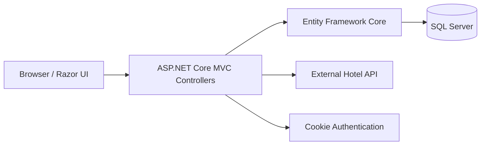

<div align="center">
  

  <br />

  <strong>A full-stack tourism discovery and booking experience built with ASP.NET Core MVC.</strong>

  <br /><br />

  <code>.NET 8</code>&nbsp;&nbsp;<code>ASP.NET Core MVC</code>&nbsp;&nbsp;<code>Entity Framework Core</code>&nbsp;&nbsp;<code>SQL Server</code>&nbsp;&nbsp;<code>Razor</code>&nbsp;&nbsp;<code>Bootstrap</code>
</div>

## About Dlily

Dlily brings the essential parts of planning a trip into one web application. Travellers can discover Egyptian attractions, browse hotels and rooms, connect with local tour guides, manage their account, and collect booking choices in a cart.

The project uses server-rendered Razor views and follows the MVC pattern, backed by Entity Framework Core and SQL Server. Seed data provides destinations, accommodation, offers, rooms, and guide profiles for a ready-to-explore local experience.

## Experience highlights

- **Destination discovery** — browse tourist places, filter attractions, and open detailed destination pages.
- **Hotels and rooms** — explore hotel listings, facilities, room details, pricing, and availability information.
- **Local tour guides** — view guide profiles, spoken languages, ratings, and prices.
- **Traveller accounts** — sign up, sign in, sign out, and maintain a personal profile with an uploaded photo.
- **Trip cart and checkout** — add rooms or guides to an in-memory cart and review the total before checkout.
- **Travel companies and offers** — discover packages and company offers seeded in the application database.
- **Protected experiences** — cookie authentication protects account, hotel, company, guide, and translation pages.
- **Responsive interface** — Razor, Bootstrap, custom CSS, JavaScript, and Font Awesome power the UI.

## Destination gallery

<div align="center">
  
  
  <br />
  
  
</div>

## How it works



## Project structure

```text
dlily_project/
├── Controllers/       MVC endpoints for auth, hotels, attractions, cart, and profiles
├── DAL/
│   ├── Models/        Domain entities and relationships
│   └── ApplicationDbContext.cs
├── Migrations/        Entity Framework Core database migrations
├── ViewModels/        Presentation models for forms and pages
├── Views/             Razor views grouped by feature
└── wwwroot/           CSS, JavaScript, libraries, images, and video assets
```

## Data model

The SQL Server database includes these main entities:

| Area | Entities |
|---|---|
| People | `Tourist`, `Tourgide` |
| Discovery | `TouristPlaces` |
| Accommodation | `Hotel`, `Room` |
| Offers | `CompanyOffer` |
| Feedback | `ReviewHotel`, `ReviewCompany` |
| Shopping | `CartItem` |

## Getting started

### Prerequisites

- [.NET 8 SDK](https://dotnet.microsoft.com/download/dotnet/8.0)
- SQL Server or SQL Server LocalDB
- Visual Studio 2022, Rider, or VS Code with C# tooling

### Run locally

1. Clone the repository:

   ```bash
   git clone https://github.com/hasan-elbadry/dlily_project_MVC.git
   cd dlily_project_MVC
   ```

2. Update `dlily_project/appsettings.json` if your SQL Server connection differs from the included LocalDB configuration:

   ```json
   {
     "ConnectionStrings": {
       "DefaultConnection": "Data Source=(localdb)\\ProjectModels;Initial Catalog=DlilyDB;Integrated Security=True;Trust Server Certificate=True"
     }
   }
   ```

3. Restore dependencies and apply the migrations:

   ```bash
   dotnet restore
   dotnet ef database update --project dlily_project
   ```

4. Start the application:

   ```bash
   dotnet run --project dlily_project
   ```

5. Open the HTTP URL printed in the terminal (the included launch profile uses `http://localhost:5289`).

> The application calls an external hotel API for its hotel catalogue, so that experience also requires an internet connection.

## Tech stack

| Layer | Technology |
|---|---|
| Runtime | .NET 8 |
| Web framework | ASP.NET Core MVC |
| Language | C# |
| Data access | Entity Framework Core 9 |
| Database | SQL Server / LocalDB |
| Authentication | ASP.NET Core cookie authentication |
| Views | Razor, HTML5, Bootstrap, custom CSS |
| Client-side | JavaScript, jQuery, Font Awesome |
| Integration | `HttpClient` and a remote hotel API |

## Current scope

This repository is an educational portfolio project. Its cart is currently stored in application memory, and the authentication implementation is custom rather than ASP.NET Core Identity. For production use, consider persisted per-user carts, password hashing/Identity, secret management, resilient API handling, automated tests, and deployment-specific configuration.

## Contributors

Built collaboratively by [Hasan Elbadry](https://github.com/hasan-elbadry) and [Mostafa Medhat](https://github.com/MostafaMedhat19).
